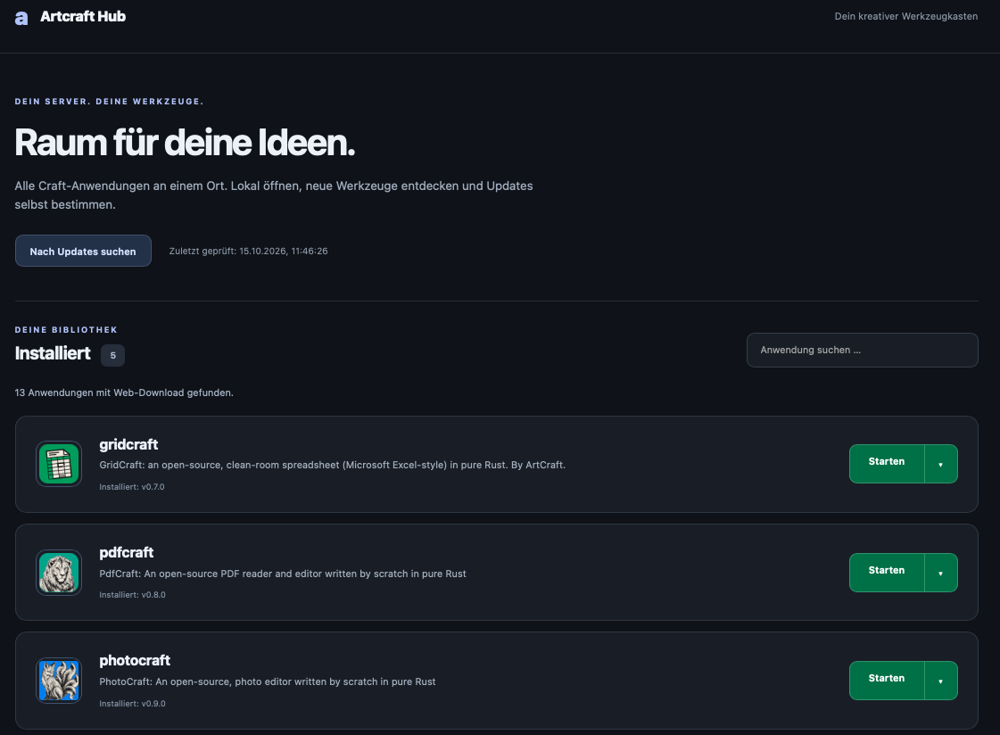
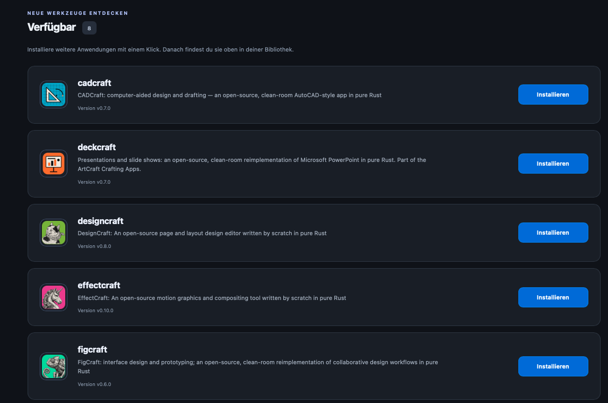

# Artcraft Hub für Docker

**Aktuelle Version: [0.2](https://github.com/Wolf6660/Artcaft-Weblauncher/tree/v0.2)**

Ein unabhängiger, selbst gehosteter Launcher für die [Craft-Webanwendungen von storytold](https://github.com/orgs/storytold/repositories?type=all). Anwendungen direkt im Browser starten, weitere Werkzeuge installieren und verfügbare Web-Releases bei Bedarf aktualisieren.

Für **Synology NAS mit Container Manager** und **Linux-Server mit Docker Compose V2**. Kein GitHub-Konto für den normalen Betrieb erforderlich.

> Dieses Projekt ist kein offizielles Artcraft-Produkt und wird nicht von storytold betrieben. Die jeweiligen Anwendungen, Namen und Icons gehören ihren jeweiligen Rechteinhabern.

<table>
  <tr>
    <td width="50%" valign="top">
      <a href="1.png"></a>
    </td>
    <td width="50%" valign="top">
      <a href="2.png"></a>
    </td>
  </tr>
</table>

## Funktionen

- **Installiert:** Anwendungen mit grünem Startbutton und Dropdown für Update, vorherige Version und Deinstallation.
- **Verfügbar:** noch nicht installierte Webanwendungen mit blauem Installationsbutton.
- GitHub-Kurzbeschreibungen; ein Klick auf den Anwendungsnamen öffnet die README im jeweiligen GitHub-Repository.
- Oben rechts Links zum Weblauncher und zu den Repositories der Softwarehersteller.
- Aktuelle Hub-Version unten rechts; Versionsstand in der Datei `VERSION`.
- Originalicons werden vom Server geladen und unter `data/icons` zwischengespeichert.
- Automatische Prüfung auf neue Releases alle zwölf Stunden; Installationen und Updates ausschließlich auf Klick.
- Vorherige verwaltete Version bleibt für einen Rollback erhalten.
- Bestehende manuelle Anwendungen in `public` bleiben nutzbar.
- Mitgelieferter Startkatalog mit 13 zum Erstellungszeitpunkt geprüften Web-Releases. Dadurch bleibt die Anwendungsauswahl auch ohne erfolgreichen ersten API-Abruf sichtbar.

## Voraussetzungen

- Docker Engine mit Docker Compose V2, auf Synology entsprechend Container Manager.
- Freier Hostport, standardmäßig **31000**.
- Ausgehender Internetzugriff auf Docker Hub beim Bauen sowie GitHub, `raw.githubusercontent.com` und GitHubs Download-CDNs für Katalog, Downloads und Beschreibungen.
- Schreibrechte für den Datenordner `data`.

Das Image wird aus `python:3.13-alpine` für die Architektur des Docker-Hosts gebaut. Die Craft-Anwendungen werden als fertige Web-/WebAssembly-Pakete installiert; ein Rust-Build ist nicht nötig.

## Installation unter Linux

Das Repository klonen und die Docker-Anwendung starten:

```sh
git clone https://github.com/Wolf6660/Artcaft-Weblauncher.git
cd Artcaft-Weblauncher
mkdir -p public data
cp .env.example .env
# Optional: .env bearbeiten
docker compose up -d --build
```

Anschließend im Browser `http://SERVER-IP:31000` öffnen.

Die Volume-Pfade `./public` und `./data` beziehen sich auf das Projektverzeichnis. Es sind keine festen Synology-Pfade nötig.

## Installation auf Synology

1. Die Projektdateien beispielsweise unter `/volume1/docker/artcraft` ablegen. `Dockerfile`, `compose.yaml`, `server.py`, `catalog-default.json`, `VERSION` und der komplette Ordner `dashboard` müssen vorhanden sein.
2. Die Ordner `public` und `data` anlegen, falls sie fehlen. Bestehende Anwendungsordner und Daten behalten.
3. `.env.example` als `.env` kopieren und bei Bedarf bearbeiten.
4. Einen bisherigen Container mit gleichem Namen oder Port vor der Umstellung stoppen und entfernen. Die Datenordner behalten.
5. In **Container Manager → Projekt → Erstellen** das Projektverzeichnis und die vorhandene `compose.yaml` auswählen, anschließend bauen und starten.
6. `http://NAS-IP:31000` öffnen.

Alternativ per SSH:

```sh
cd /volume1/docker/artcraft
sudo docker compose up -d --build
```

## Einstellungen in `.env`

Die Datei liegt **direkt neben `compose.yaml`**:

```dotenv
ARTCRAFT_PORT=31000
ADMIN_PASSWORD=
GITHUB_TOKEN=
```

| Variable | Bedeutung |
| --- | --- |
| `ARTCRAFT_PORT` | Port der Startseite auf dem Host, standardmäßig `31000`. |
| `ADMIN_PASSWORD` | Optionaler Passwortschutz. Benutzername ist `admin`. Leer bedeutet ohne Anmeldung. |
| `GITHUB_TOKEN` | Optionaler persönlicher GitHub-Token für ein höheres API-Limit, insbesondere bei häufigen Update-Prüfungen. |

Das Prüfintervall wird über `CHECK_INTERVAL_HOURS` in `compose.yaml` eingestellt. Der Mindestabstand automatischer Prüfungen beträgt eine Stunde. Erfolgreiche vollständige Prüfungen werden mindestens zehn Minuten wiederverwendet.

Nach Änderungen an `.env` den Container **neu erstellen**, nicht nur neu starten:

```sh
docker compose up -d --force-recreate
```

## GitHub-API und optionaler Token

**Ein Token ist für den normalen Betrieb nicht vorgeschrieben.** Ohne Token kann GitHub seine API nach Erreichen des Abfragelimits vorübergehend sperren. Das kann insbesondere bei wiederholten Update-Prüfungen auftreten. Andere Dienste hinter derselben öffentlichen IP teilen das anonyme Budget.

GitHub erlaubt anonyme REST-Abfragen normalerweise mit einem Budget von **60 Anfragen pro Stunde und IP-Adresse**. Ein persönlicher Token erhöht das übliche Budget auf **5.000 Anfragen pro Stunde**. Maßgeblich sind die aktuellen [GitHub-API-Limits](https://docs.github.com/en/rest/using-the-rest-api/rate-limits-for-the-rest-api).

Der Hub erkennt API-Limits, pausiert weitere API-Abfragen und zeigt die von GitHub gemeldete Freigabezeit an. Bereits gefundene Anwendungen und erfolgreiche Teilresultate bleiben erhalten. Der Startkatalog, der direkte README-Abruf und die Icons benötigen keine GitHub-API-Abfrage. Neue Anwendungen und aktuelle Release-Informationen können während der Sperre jedoch nicht vollständig ermittelt werden.

### Token erstellen

Für einen persönlichen Token benötigst du ein kostenloses **eigenes GitHub-Konto**. Du musst weder Eigentümer der storytold-Repositories noch Mitglied der Organisation sein: Die Daten sind öffentlich, und der Token wird hier nur zum Lesen verwendet.

Eine einfache Möglichkeit ist ein klassischer Token ohne zusätzliche Berechtigungen:

1. Bei GitHub anmelden und [Settings → Developer settings → Personal access tokens → Tokens (classic)](https://github.com/settings/tokens) öffnen.
2. **Generate new token → Generate new token (classic)** auswählen. [Direktlink zum Formular](https://github.com/settings/tokens/new).
3. Bei **Note** beispielsweise `Artcraft Hub` eintragen.
4. Bei **Expiration** ein Ablaufdatum wählen. Nach Ablauf muss der Token ersetzt oder die Variable wieder geleert werden.
5. Unter **Select scopes** für diesen Zugriff auf öffentliche Informationen **keine Häkchen setzen**. Insbesondere werden keine Schreibrechte und kein `repo`-Scope benötigt.
6. **Generate token** anklicken und den Token kopieren.

GitHub unterstützt auch feingranulare Tokens; diese haben grundsätzlich Lesezugriff auf öffentliche Repositories. Weitere Informationen und die aktuellen Menüpunkte stehen in der [GitHub-Anleitung zu persönlichen Zugriffstokens](https://docs.github.com/de/authentication/keeping-your-account-and-data-secure/managing-your-personal-access-tokens).

### Token eintragen

Den Token ausschließlich in deiner lokalen `.env` neben `compose.yaml` hinterlegen:

```dotenv
GITHUB_TOKEN=HIER_DEINEN_TOKEN_EINTRAGEN
```

Danach im Projektverzeichnis:

```sh
docker compose up -d --force-recreate
```

Auf Synology alternativ das Projekt mit den aktualisierten Einstellungen neu erstellen. Eine zuvor gespeicherte API-Pause wird bei einem geänderten Token nicht übernommen. Anschließend kann im Hub erneut auf Updates geprüft werden.

**Den Token niemals in `compose.yaml`, öffentliche Screenshots, Issues oder dieses Repository kopieren.** `.env` ist in `.gitignore` und `.dockerignore` ausgeschlossen. `.env.example` enthält nur leere Beispielwerte.

Ohne Konto und Token die Variable einfach leer lassen:

```dotenv
GITHUB_TOKEN=
```

## Daten und vorhandene Anwendungen

```text
.
├── Dockerfile
├── compose.yaml
├── server.py
├── catalog-default.json
├── VERSION
├── .env.example
├── dashboard/
├── public/                 # Manuell vorhandene Webanwendungen
│   └── pdfcraft/
│       └── index.html
└── data/                   # Vom Hub verwaltete Installationen und Cache
```

Manuelle Anwendungen werden unter `public/<anwendung>/index.html` erkannt. Der Container bindet diesen Ordner schreibgeschützt ein. Vom Hub installierte Versionen liegen separat unter `data/apps` und haben beim Aufruf Vorrang vor einer manuellen Kopie gleichen Namens.

Bei einer Deinstallation entfernt der Hub seine verwalteten Versionen einschließlich Rollback-Versionen. Eine manuelle Kopie in `public` bleibt unverändert, wird aber für den Hub dauerhaft deaktiviert. Die Anwendung erscheint wieder unter „Verfügbar“, sofern sie im Katalog enthalten ist.

Die Ordner enthalten `.gitkeep`, damit Git auch die zunächst leeren Ordner mitführt. Anwendungsdaten, manuell kopierte Webpakete und persönliche `.env`-Dateien werden durch `.gitignore` ausgeschlossen.

## Updates und Sicherung

**Craft-Anwendungen:** im Hub nach Updates suchen und die gewünschte Anwendung aktualisieren. Vorher offene Dokumente speichern, anschließend bestehende Anwendungstabs neu laden. Ein Rollback ist ab der zweiten erfolgreichen verwalteten Installation möglich.

**Den Hub selbst:** neue Projektdateien aus diesem Repository übernehmen und das Image neu bauen:

```sh
git pull
docker compose up -d --build
```

Das gilt nur für eine per Git geklonte Installation. Bei manuell kopierten Dateien diese zunächst ersetzen. Die Updatebuttons im Hub aktualisieren die Craft-Anwendungen, nicht das Docker-Image des Hubs.

Für Backups den Container stoppen und `public`, `data` und `.env` sichern. Der Hub ist kein Dokumentenserver: Dokumente und Einstellungen innerhalb einer Craft-Anwendung werden von deren eigenen Browserfunktionen verwaltet.

## Grenzen und Prüfstand

Die automatische Erkennung unterstützt Repositories mit `craft` am Namensende und einem eindeutigen fertigen Web-ZIP im neuesten stabilen GitHub-Release. Desktoppakete, eigene Rust-Builds und GitHub-Prereleases werden nicht automatisch installiert. Der mitgelieferte Katalog ist eine Momentaufnahme; neue Releases werden durch die Online-Prüfung erkannt.

README-Inhalte werden mit GitHub-kompatibler Markdown-Darstellung und gefiltertem HTML angezeigt, einschließlich Bildern, Badges, Tabellen und Bildgalerien. Relative Bild- und Linkpfade werden zum jeweiligen Repository aufgelöst. Skripte, Ereignishandler, eingebettete Frames und aktive HTML-Inhalte werden entfernt. Bilder von GitHub-Raw-Hosting und Shields.io werden über den Hub zwischengespeichert und lokal ausgeliefert; SVG-Bilder erhalten eine restriktive Content-Security-Policy. Andere Bildhosts werden derzeit nicht unterstützt. Die lokal mitgelieferten Bibliotheken [Marked](https://marked.js.org/) und [DOMPurify](https://github.com/cure53/DOMPurify) sowie ihre Lizenzen liegen unter `dashboard/vendor`; ein Browser-CDN wird nicht benötigt. Ein Container-Docker-Socket ist nicht erforderlich.

Die lokale Oberfläche einschließlich Originalicons sowie Katalog, Cache und Offline-Fallback wurden in der Entwicklungsumgebung geprüft. Ein tatsächlicher Docker-Build und Betrieb auf Synology bzw. einem Linux-Server konnte dort mangels Docker nicht geprüft werden.
